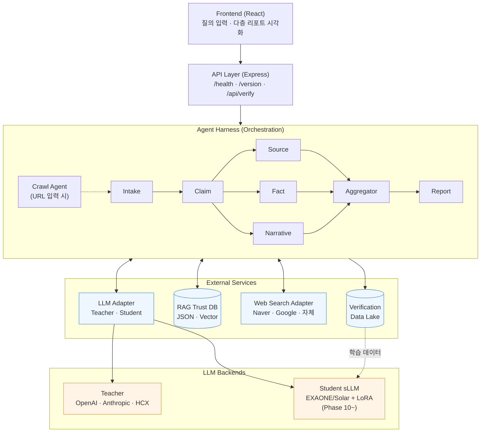
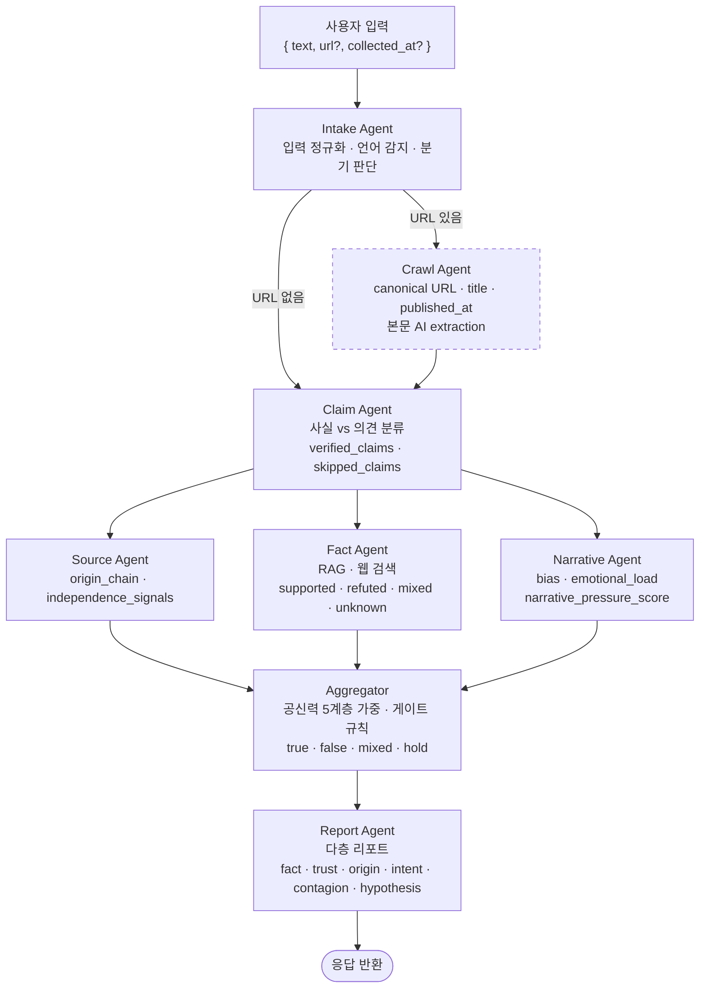
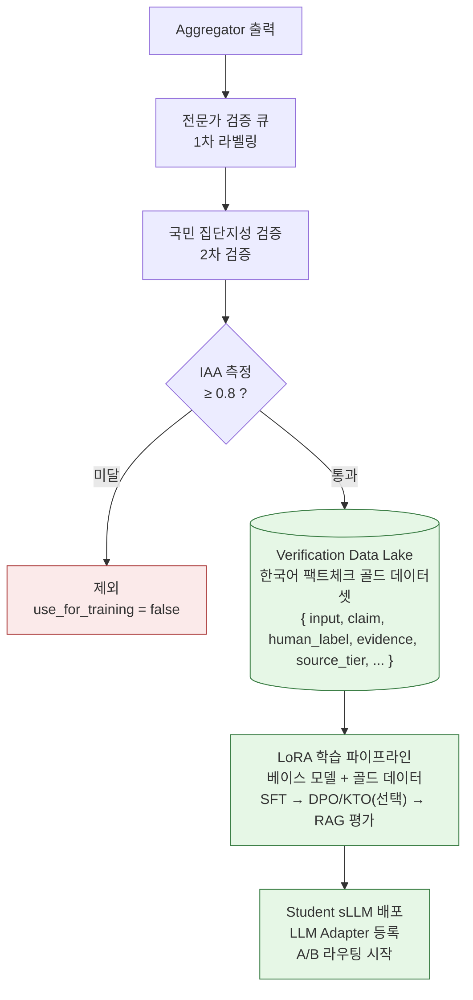
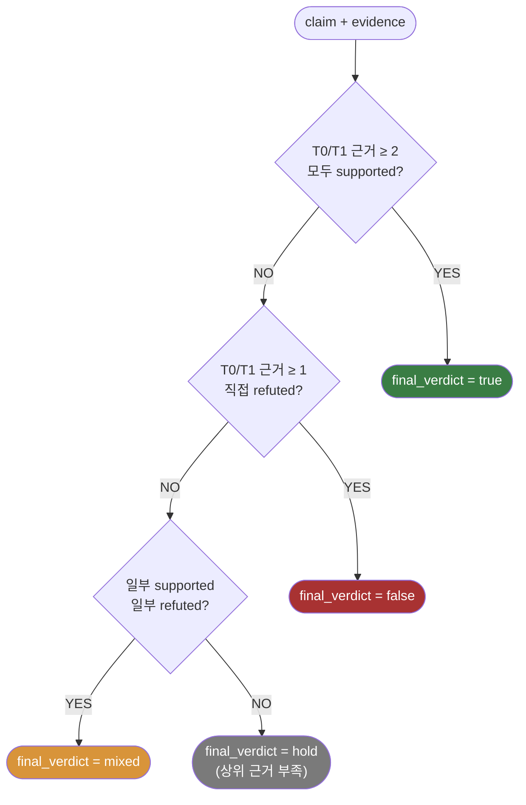
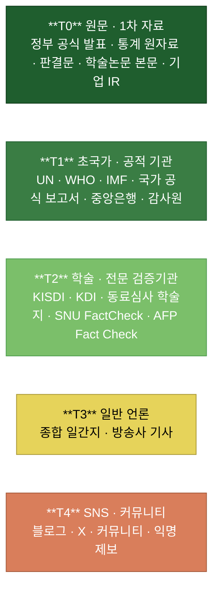
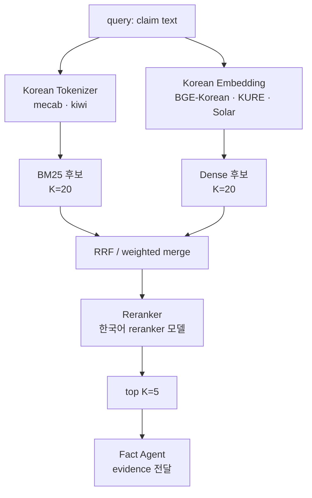
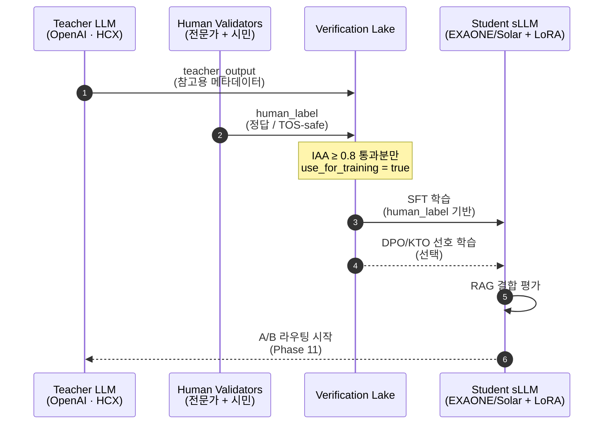
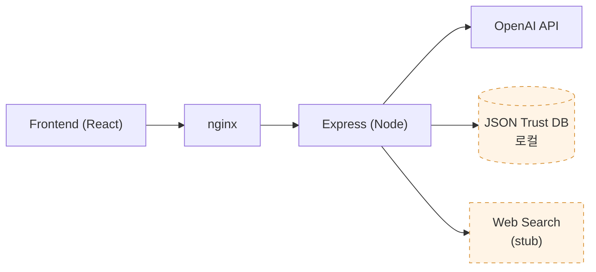
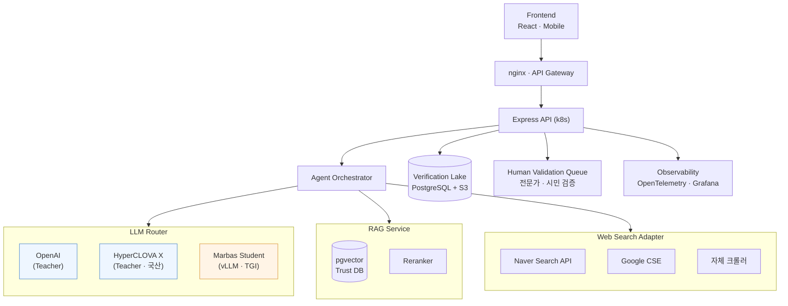
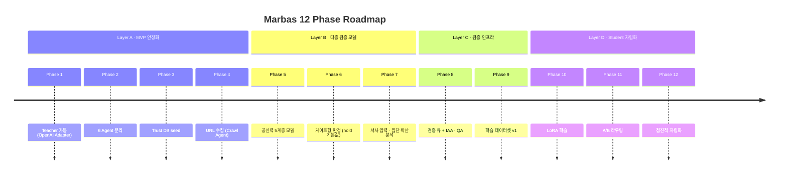

# Marbas — 기술 설계서 (Technical Architecture)

> 작성일: 2026-04-28
> 대상: 내부 기술 설계 문서 (수요조사서 [ref.md](./ref.md) 의 구현 방안 ①~⑤를 시스템 설계로 구체화)
> 코드명: Marbas — 한국어 이슈 검증 / 팩트체크 시스템

---

## 목차

- [1. 설계 원칙](#1-설계-원칙)
- [2. 시스템 아키텍처 (전체 구성)](#2-시스템-아키텍처-전체-구성)
- [3. 데이터 플로우](#3-데이터-플로우)
  - [3.1 입력 → 응답 흐름](#31-입력--응답-흐름)
  - [3.2 학습 데이터 자산화 흐름 (오프라인)](#32-학습-데이터-자산화-흐름-오프라인)
- [4. 에이전트 명세](#4-에이전트-명세)
  - [4.1 Intake Agent](#41-intake-agent)
  - [4.2 Claim Agent](#42-claim-agent)
  - [4.3 Source Agent](#43-source-agent)
  - [4.4 Fact Agent](#44-fact-agent)
  - [4.5 Narrative Agent](#45-narrative-agent)
  - [4.6 Aggregator](#46-aggregator)
  - [4.7 Report Agent](#47-report-agent)
  - [4.8 Crawl/Collection Agent](#48-crawlcollection-agent)
- [5. 신뢰 출처 데이터베이스 (Trust DB)](#5-신뢰-출처-데이터베이스-trust-db)
  - [5.1 공신력 5계층](#51-공신력-5계층)
  - [5.2 trusted_db 레코드 스키마](#52-trusted_db-레코드-스키마)
  - [5.3 검색 인덱스](#53-검색-인덱스)
- [6. RAG 아키텍처](#6-rag-아키텍처)
  - [6.1 검색 파이프라인](#61-검색-파이프라인)
  - [6.2 RAG 운영 정책](#62-rag-운영-정책)
- [7. LLM Adapter & Teacher/Student 증류 전략](#7-llm-adapter--teacherstudent-증류-전략)
  - [7.1 LLM Adapter 인터페이스](#71-llm-adapter-인터페이스)
  - [7.2 증류 전략](#72-증류-전략)
- [8. 베이스 모델 선정 기준](#8-베이스-모델-선정-기준)
  - [8.1 후보 비교](#81-후보-비교)
  - [8.2 1순위 / 2순위 / 백업](#82-1순위--2순위--백업)
  - [8.3 선정 기준 가중치](#83-선정-기준-가중치)
- [9. API 계약 (확장)](#9-api-계약-확장)
  - [9.1 POST /api/verify 요청](#91-post-apiverify-요청)
  - [9.2 응답 (확장 스키마)](#92-응답-확장-스키마)
- [10. 평가 메트릭](#10-평가-메트릭)
  - [10.1 시스템 KPI](#101-시스템-kpi)
  - [10.2 차별화 KPI](#102-차별화-kpi)
  - [10.3 벤치마크](#103-벤치마크)
- [11. 배포 아키텍처](#11-배포-아키텍처)
  - [11.1 현재 (Phase 1)](#111-현재-phase-1)
  - [11.2 목표 (Phase 5+)](#112-목표-phase-5)
  - [11.3 인프라 요구사항](#113-인프라-요구사항-student-sllm-운영-기준)
- [12. 단계별 구현 로드맵 (Phase 매핑)](#12-단계별-구현-로드맵-phase-매핑)
- [13. 리스크와 완화](#13-리스크와-완화)
- [14. 참고 / 연결 문서](#14-참고--연결-문서)

---

## 1. 설계 원칙

| 원칙 | 의미 |
|---|---|
| **외부 근거 우선** | LLM의 사전지식이 아니라 **신뢰 출처 DB + 실시간 검색**이 판정의 기반 |
| **억지 판정 금지** | 상위 계층 근거가 없으면 기본값은 **`hold`**. "모르는 것은 모른다"가 KPI |
| **역할 분리** | 단일 거대 프롬프트 대신 **에이전트별 역할 분리**. 디버깅·개선·교체가 가능 |
| **단계적 자립화** | 상용 Teacher LLM → 인간 검증 데이터 → 국산 Student sLLM (LoRA + RAG) |
| **사실/서사 분리** | 사실 판정과 편향·서사 압력·집단 확산은 별도 채널로 출력. 섞지 않음 |
| **인과/이권은 가설** | 인과 추정과 이해관계 추정은 사실 판정과 분리된 **가설층**으로만 노출 |

---

## 2. 시스템 아키텍처 (전체 구성)



---

## 3. 데이터 플로우

### 3.1 입력 → 응답 흐름



### 3.2 학습 데이터 자산화 흐름 (오프라인)



---

## 4. 에이전트 명세

### 4.1 Intake Agent

| 항목 | 내용 |
|---|---|
| 역할 | 입력 정규화, 분기 판단, 메타데이터 추출 |
| 입력 | `{ text, url?, collected_at? }` |
| 출력 | `{ normalized_text, lang, has_url, metadata }` |
| LLM 호출 | 1회 (소규모, gpt-4o-mini급) |
| 실패 처리 | text 비어있으면 400 에러 |

### 4.2 Claim Agent

| 항목 | 내용 |
|---|---|
| 역할 | 검증 가능한 사실 주장만 추출, 의견 분리 |
| 입력 | normalized_text |
| 출력 | `{ verified_claims: [{ id, text, type, needs_verification }], skipped_claims: [{ text, reason }] }` |
| 분류 기준 | `type ∈ { factual, opinion, prediction, normative }` |
| 후속 호출 조건 | `type === "factual" && needs_verification === true` |

### 4.3 Source Agent

| 항목 | 내용 |
|---|---|
| 역할 | claim의 최초 출처와 타임라인 추적 |
| 입력 | claim, web_search 결과 |
| 출력 | `{ origin_chain[], independence_signals, primary_source_found, source_tier }` |
| 핵심 로직 | 동일 원문 재인용 → 독립 출처 1건으로 카운트 |

### 4.4 Fact Agent

| 항목 | 내용 |
|---|---|
| 역할 | claim을 외부 근거와 대조하여 판정 |
| 입력 | claim, RAG hits, web_search 결과 |
| 출력 | `{ verdict: supported\|refuted\|mixed\|unknown, confidence, evidence[] }` |
| evidence 필드 | `{ text, source, source_tier, independence_class, credibility_weight }` |

### 4.5 Narrative Agent

| 항목 | 내용 |
|---|---|
| 역할 | 편향, 선동성, 감정 유발, 서사 압력 분석 |
| 입력 | normalized_text, claim |
| 출력 | `{ bias_score, emotional_load, narrative_pressure_score, propaganda_signals[] }` |
| 분리 원칙 | 사실 판정과 **독립 채널**로 출력 — 섞지 않음 |

### 4.6 Aggregator

게이트 규칙 (재정의):



추가 규칙:
- 동일 원문에서 파생된 evidence는 **독립 1건**으로만 카운트
- T3/T4 만으로는 `true`/`false` 판정 불가 (`hold`)
- `narrative_pressure_score > threshold` 면 `warnings`에 별도 표시 (판정에는 영향 없음)

### 4.7 Report Agent

다층 출력 구조:

```json
{
  "verdict": "true|false|mixed|hold",
  "confidence": 0.0~1.0,
  "why": {
    "fact":      "근거 대조 결과 요약",
    "trust":     "출처 신뢰도/독립성 요약",
    "origin":    "최초 출처와 타임라인",
    "intent":    "편향·선동성 분석",
    "contagion": "집단 확산 리스크",
    "hypothesis":"이해관계/인과 가설 (참고)"
  },
  "citations": [...],
  "warnings":  [...]
}
```

### 4.8 Crawl/Collection Agent

| 항목 | 내용 |
|---|---|
| 역할 | URL 입력 시 본문 수집 |
| Deterministic 부분 | canonical URL, title, published_at 메타데이터만 |
| AI-assisted 부분 | 본문 정리, 핵심 문장 추출, 노이즈 제거 |
| 실패 시 | text 기반 fallback, warning 기록 |

---

## 5. 신뢰 출처 데이터베이스 (Trust DB)

### 5.1 공신력 5계층



| Tier | 정의 | 예시 | 단독 판정 권한 |
|---|---|---|---|
| **T0** | 원문·1차 자료 | 정부 공식 발표, 통계청 원자료, 법원 판결문 원본, 학술 논문 본문, 기업 IR 공시 | true/false 가능 |
| **T1** | 초국가·공적 기관 | UN/WHO/IMF 발표, 국가 공식 보고서, 중앙은행 통계, 감사원 보고서 | true/false 가능 |
| **T2** | 학술·전문 검증기관 | KISDI/KDI 보고서, 동료심사 학술지, 전문 팩트체크 기관(SNU FactCheck, AFP Fact Check 등) | 보강 근거로만 |
| **T3** | 일반 언론 | 종합 일간지·방송사 기사 | hold (단독 불가) |
| **T4** | SNS·커뮤니티 | 개인 블로그, 트위터/X, 커뮤니티 게시물, 익명 제보 | hold (단독 불가) |

### 5.2 trusted_db 레코드 스키마

```json
{
  "id": "kostat_2024_population",
  "source_name": "통계청 인구동향조사 2024",
  "source_url": "https://kostat.go.kr/...",
  "source_tier": "T0",
  "independence_class": "primary",
  "interest_risk": "low",
  "country_scope": "KR",
  "published_at": "2024-12-15",
  "topics": ["인구", "출산율", "통계"],
  "claims_supported": [
    {
      "claim": "2024년 합계출산율은 0.72명이다",
      "evidence_text": "...",
      "page_or_section": "표 3-2"
    }
  ],
  "credibility_weight": 1.0,
  "embedding": [/* vector */]
}
```

### 5.3 검색 인덱스

| 단계 | 방식 |
|---|---|
| 현재 (Phase 1~2) | JSON 키워드 매칭 ([trustedDb.js](../src/services/rag/trustedDb.js)) |
| Phase 3+ | 한국어 임베딩(BGE-Korean / KURE / Solar Embedding) + FAISS / pgvector |
| Phase 5+ | 하이브리드(BM25 + dense) + reranker (한국어 reranker 모델) |

---

## 6. RAG 아키텍처

### 6.1 검색 파이프라인



### 6.2 RAG 운영 정책

- **출처 기록 의무**: 모든 evidence는 `source_id`, `source_tier`, `quoted_text`, `match_score`를 포함
- **신선도(staleness) 처리**: `published_at < (now - X일)` 인 경우 `staleness_warning`
- **하위 계층 단독 인용 금지**: T3/T4만 hit하면 `low_tier_only_warning` + 상위 계층 보강 검색 시도
- **출처 표기 강제**: Fact Agent 응답에 evidence가 비어있으면 자동 `unknown`

---

## 7. LLM Adapter & Teacher/Student 증류 전략

### 7.1 LLM Adapter 인터페이스

```javascript
// 공통 인터페이스
interface LlmAdapter {
  name: string;           // "openai" | "anthropic" | "hyperclovax" | "ollama" | "marbas-student"
  tier: "teacher" | "student" | "local";
  cost_per_1k: number;
  generate(prompt, schema, options): Promise<JsonResponse>;
  health(): Promise<HealthStatus>;
}
```

각 어댑터:

| Adapter | 역할 | 사용 시점 |
|---|---|---|
| `OpenAIAdapter` | Teacher | Phase 1~ (현재) |
| `AnthropicAdapter` | Teacher (백업/비교) | Phase 1~ |
| `HyperClovaXAdapter` | Teacher (국산) | Phase 2~ — 데이터 주권 옵션 |
| `OllamaAdapter` | 로컬 개발/테스트 | 옵션 |
| `MarbasStudentAdapter` | Student sLLM | Phase 5~ |

라우팅 규칙 (Phase 5 이후):
- 단순 분류·추출 → Student
- 복잡 추론·요약 → Teacher
- 동일 입력에 대해 Teacher/Student 출력 비교 → 학습 신호 누적

### 7.2 증류 전략



**학습 데이터 구성**:

```
{
  "input": { "text": "...", "context": [...] },
  "instruction": "이 주장을 검증하라",
  "teacher_output": { "verdict": "...", "evidence": [...] },
  "human_label": {
    "verdict": "...",
    "confidence": 0.95,
    "validators": ["expert_001", "expert_023", "crowd_consensus_v3"],
    "iaa": 0.87
  },
  "use_for_training": true   // IAA ≥ 0.8 만 true
}
```

**LoRA 학습 단계**:

1. **SFT (Supervised Fine-tuning)**: human_label을 정답으로 사용
2. **DPO / KTO** (선택): 사람이 선택한 응답 vs Teacher 오답 쌍으로 선호 학습
3. **RAG 통합 평가**: 학습된 Student가 RAG와 결합 시 성능 측정

**약관(TOS) 회피 핵심**:
- Teacher 출력을 **그대로** 학습 라벨로 쓰지 않음
- 항상 `human_label`을 정답으로 사용 → 데이터셋 출처는 "전문가·국민 검증 결과"
- Teacher 출력은 **참고용 메타데이터**로만 보관

---

## 8. 베이스 모델 선정 기준

### 8.1 후보 비교

| 모델 | 파라미터 | 한국어 품질 | 라이선스 | 공공사업 정합성 | LoRA 친화성 | 비고 |
|---|---|---|---|---|---|---|
| **EXAONE 3.5** | 7.8B / 32B | ★★★★★ | EXAONE License (연구·상업 가능) | ★★★★★ (국산 1순위) | ★★★★ | LG AI Research, 공공 친화 |
| **SOLAR / Solar Pro** | 22B | ★★★★★ | Apache 2.0 (Solar 10.7B) / 상용 라이선스 (Pro) | ★★★★★ | ★★★★★ | Upstage, 한국어 SOTA |
| **Kanana** | 2.1B / 8B | ★★★★ | 부분 공개 | ★★★★ | ★★★ | Kakao, 최근 공개 |
| **A.X (LG U+)** | 다양 | ★★★ | 협의 | ★★★★ | 협의 | 통신사 기반 |
| **HyperCLOVA X** | 비공개 | ★★★★★ | API 전용 | ★★★ | LoRA 불가 (API) | NAVER, 자체 학습 옵션 별도 협의 |
| **Qwen 2.5** | 0.5B~72B | ★★★★ | Apache 2.0 (대부분) | ★★ (해외) | ★★★★★ | 알리바바. 백업·비교군 |
| **Llama 3.1** | 8B / 70B | ★★★ | Llama Community License | ★★ (해외) | ★★★★★ | Meta. 백업·비교군 |

### 8.2 1순위 / 2순위 / 백업

- **1순위**: **EXAONE 3.5 (7.8B)** — 한국어 + 국산 + LoRA 가능 + 공공사업 친화
- **2순위**: **Solar 10.7B / Solar Pro** — 한국어 SOTA, Apache 2.0 라이선스 자유도
- **백업**: Qwen 2.5 / Llama 3.1 — 비교군 또는 PoC 단계 검증용

### 8.3 선정 기준 가중치

| 기준 | 가중치 |
|---|---|
| 한국어 품질 (KMMLU / HAERAE-Bench / KoBEST 등) | 30% |
| 라이선스 자유도 (상업·재학습 가능) | 20% |
| 공공사업 정합성 (국산 / 데이터 주권) | 20% |
| LoRA·QLoRA 학습 효율 | 15% |
| 추론 비용·지연 (서비스 운영성) | 10% |
| 커뮤니티·생태계 | 5% |

---

## 9. API 계약 (확장)

### 9.1 `POST /api/verify` 요청

```json
{
  "text": "필수. 검증 대상 텍스트",
  "url": "선택. URL 제공 시 Crawl Agent가 본문 수집",
  "collected_at": "선택. ISO8601",
  "options": {
    "lang": "ko|en|auto",
    "depth": "fast|standard|deep",
    "include_hypothesis": true
  }
}
```

### 9.2 응답 (확장 스키마)

```json
{
  "input_enrichment": {
    "lang": "ko",
    "url_resolved": true,
    "article_meta": { "title": "...", "published_at": "..." }
  },
  "verified_claims": [
    {
      "claim": "...",
      "agg": {
        "final_verdict": "true|false|mixed|hold",
        "score_breakdown": {
          "fact_confidence": 0.85,
          "source_reliability": 0.92,
          "independence_score": 0.7,
          "interest_risk": 0.2,
          "narrative_pressure_score": 0.4,
          "social_contagion_score": 0.3
        }
      },
      "report": {
        "verdict": "...",
        "confidence": 0.85,
        "why": {
          "fact": "...",
          "trust": "...",
          "origin": "...",
          "intent": "...",
          "contagion": "...",
          "hypothesis": "..."
        },
        "citations": [
          {
            "source_id": "...",
            "source_tier": "T0",
            "independence_class": "primary",
            "credibility_weight": 1.0,
            "quoted_text": "...",
            "url": "..."
          }
        ],
        "warnings": ["..."]
      }
    }
  ],
  "skipped_claims": [
    { "text": "...", "reason": "opinion|prediction|normative|unverifiable" }
  ]
}
```

---

## 10. 평가 메트릭

### 10.1 시스템 KPI

| 메트릭 | 정의 | 목표 |
|---|---|---|
| **Accuracy** | 인간 라벨 대비 정확도 | ≥ 0.85 |
| **F1 (factual claims)** | 사실 주장 분류 F1 | ≥ 0.80 |
| **Hold rate** | 전체 claim 중 `hold` 비율 | 적정 구간 (15~30%) |
| **False True rate** | 거짓을 참으로 판정한 비율 | ≤ 0.03 (가장 엄격) |
| **Citation coverage** | evidence가 있는 claim 비율 | ≥ 0.95 |
| **Latency p95** | 응답 시간 (단일 claim) | ≤ 8초 |
| **IAA (학습 데이터)** | 평가자 간 일치도 | ≥ 0.80 |

### 10.2 차별화 KPI

- **억지 판정 회피율**: 근거 부족 시 `hold` 선택 비율 (높을수록 좋음, 단 너무 높으면 무용)
- **상위 계층 인용률**: T0/T1 근거 포함 비율
- **독립 출처 다양성**: claim당 독립 출처 수 평균

### 10.3 벤치마크

- **자체 한국어 팩트체크 벤치마크 구축** (Phase 4 산출물)
- 외부 비교군: SNU FactCheck 데이터, KLUE, KoBEST 일부 태스크

---

## 11. 배포 아키텍처

### 11.1 현재 (Phase 1)



### 11.2 목표 (Phase 5+)



### 11.3 인프라 요구사항 (Student sLLM 운영 기준)

| 항목 | 요구 |
|---|---|
| GPU (추론) | A100 40GB ×1 또는 L40S ×1 (7B LoRA) |
| GPU (학습) | A100 80GB ×4 (LoRA 1회 학습 약 6~12시간) |
| 메모리 | 64GB+ |
| 스토리지 | 1TB+ (벡터 DB + 학습 데이터) |
| 대안 | 범정부 AI 공통기반 GPU 활용 |

---

## 12. 단계별 구현 로드맵 (Phase 매핑)



| Phase | 핵심 작업 | 산출물 | [_forAI/plan.md](../_forAI/plan.md) 매핑 |
|---|---|---|---|
| **1. Teacher 가동** | OpenAI Adapter 안정화, JSON contract 정착 | 동작하는 `/api/verify` | Phase 1 |
| **2. 6 Agent 분리** | Intake/Claim/Source/Fact/Narrative/Report 재구조 | Agent 모듈 분리 | Phase 2 |
| **3. Trust DB seed** | sample_trusted_db.json 실데이터, T0~T4 분류 | 신뢰 DB v1 | Phase 3 |
| **4. URL 수집** | Crawl Agent 도입, 메타데이터 추출 | URL 입력 활성화 | Phase 4 |
| **5. 공신력 모델** | source_tier·independence_class·interest_risk | 게이트형 aggregator | Phase 5 |
| **6. 게이트 판정** | hold 기본값, 상위 근거 강제 | 억지 판정 차단 | Phase 6 |
| **7. 서사·확산 분석** | narrative_pressure / social_contagion | 다층 리포트 | Phase 7 |
| **8. 검증 인프라** | 전문가/시민 검증 큐, IAA 측정 | Verification Lake | Phase 8 |
| **9. 학습 데이터셋** | 검증 통과분 누적, 데이터셋 v1 | 한국어 골드 데이터셋 | 신규 |
| **10. Student LoRA** | EXAONE/Solar 베이스 + LoRA 학습 | Marbas Student v0.1 | 신규 |
| **11. A/B 라우팅** | Teacher/Student 트래픽 분배 | LLM Router 가동 | 신규 |
| **12. 점진적 자립화** | Student 트래픽 비중 확대 | 비용·주권 자립 달성 | 신규 |

---

## 13. 리스크와 완화

| 리스크 | 완화 |
|---|---|
| 상용 API TOS 위반 | Teacher 출력 직접 학습 금지, **인간 검증 통과분만** 학습 풀 진입 |
| Model collapse (자기학습 루프) | IAA 임계치, 외부 벤치마크 정기 재평가 |
| 베이스 모델 라이선스 변경 | 1순위/2순위/백업 3중 채택, 포팅 가능성 유지 |
| 한국어 임베딩 품질 한계 | 하이브리드 검색(BM25+dense), reranker 도입 |
| 거짓 판정으로 인한 명예훼손 | `hold` 기본값, 정정 절차, 면책 표기, 인간 검증 필수 |
| 정치적 편향 시비 | Narrative와 Fact의 독립 채널 분리, 공신력 계층 투명 공개 |
| 검증 인력 확보 | 전문가 자문단 + 시민 검증단 투트랙, 인센티브 설계 |

---

## 14. 참고 / 연결 문서

- [ref.md](./ref.md) — 「공공AI사업지원센터」 컨설팅 수요조사서 정리 (구현 방안 ①~⑤ 재정의 포함)
- [_forAI/plan.md](../_forAI/plan.md) — Phase별 구현 계획
- [_forAI/dev_log.md](../_forAI/dev_log.md) — 개발 로그
- [readme.md](../readme.md) — 프로젝트 공개 문서
- 현재 코드 진입점: [src/server.js](../src/server.js), [src/routes/verify.js](../src/routes/verify.js)
