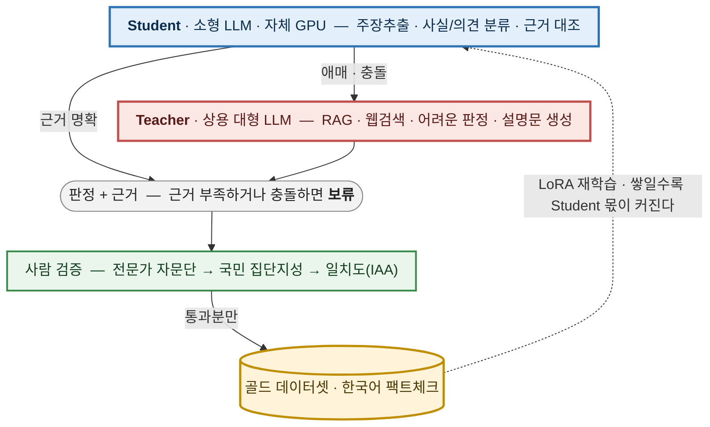

# 프로젝트 체크포인트 2026-07-28

## 목차

- [1. 요약 — 네 줄](#1-요약--네-줄)
- [2. 점검 결과 — 그대로 가는 것과 바뀌는 것](#2-점검-결과--그대로-가는-것과-바뀌는-것)
- [3. 스승과 제자 구조](#3-스승과-제자-구조)
- [4. 소형 LLM 팩트체크 — 되는 이유와 조건](#4-소형-llm-팩트체크--되는-이유와-조건)
- [5. 자체 LLM 운용의 가치 — 손익으로 환산되지 않는 것](#5-자체-llm-운용의-가치--손익으로-환산되지-않는-것)
- [6. GPU 사양과 예산 편성](#6-gpu-사양과-예산-편성)

---

> 2026-11-15 재검토 반영: 아래 장기 구상은 구현 완료나 성능 실측을 뜻하지 않는다. 현재 구현과 단계별 심사는 [문서 안내](./README.md) 및 [새 목표 종료 기록](./article_search_goal_20261115.md)을 따른다. 이 문서의 모델 후보·가격·성능 인용은 7월 구상이며 11월의 실측이나 최신 시세로 재검증하지 않았다.

## 1. 요약 — 네 줄

1. **방향은 원안 그대로다.** 이번에 논의한 에이전트, 데이터 축적, 소형 LLM 개발은 새 방향이 아니라 원래 계획서에 이미 있던 내용이다. 5단계 뼈대(상용 LLM 전처리 → 다중 에이전트 → 검증 루프 → 데이터 자산화 → 소형 LLM)는 그대로 간다.
2. **캐싱은 동일 시점·근거 버전에서 일관성을 제공한다.** 입력, 대상 시점, 정보 기준일, 증거·모델·프롬프트·규칙 버전을 키에 포함한다. 새로운 사실이나 정정이 들어오면 최신 판정을 재검증하고 이전 기록은 보존한다.
3. **소형 LLM의 적용 가능성은 작업별 평가로 확인한다.** 주장 추출·고정 근거 대조부터 시작하고, 시점·출처를 분리한 평가에서 정확도와 판정 비율을 함께 측정한다. 3분류를 6등급으로 단순 치환하지 않는다.
4. **GPU 투자는 품질·부하·운영 요건을 확인한 뒤 결정한다.** 판정 기록, 근거 버전 관리, 평가셋 구축은 API와 기존·공용·임차 자원으로도 시작할 수 있다.

---

## 2. 점검 결과 — 그대로 가는 것과 바뀌는 것

| 구분 | 내용 |
|---|---|
| **그대로** (5단계 전부) | · 사람 검증을 통과한 데이터만 학습에 쓴다 · 근거가 부족하면 억지로 판정하지 않는다 — 보류(hold) 강제 · 같은 원문을 베껴 쓴 기사 100개는 출처 1개로 센다 · 출처를 5계층(T0 원문·1차자료 ~ T4 SNS)으로 나눠 가중치를 준다 · 새 사실은 모델을 다시 학습시키지 않고 자료(RAG) DB만 갱신한다 · 한국어 팩트체크 정답 데이터셋(골드 데이터셋)을 산출물로 남긴다 |
| **바뀜 — 인프라 2가지** | ① NPU·자체 서버 구축은 뺀다 — 애초에 우리 원안에 없던 항목이다 ② 베이스 모델의 "국산" 고집을 푼다 — 대신 자격 조건(상업 이용 가능 라이선스 · 한국어 성능 · 추가학습 가능) + 성능 점수로 뽑는다 |
| **구체화** | ③ 초기 판정은 근거에 따른 지지/반박/보류로 운영. 6등급은 별도 정의·라벨링·평가 또는 검수자 판단 필요 ④ 장비·데이터·개발·검수 비용을 함께 산정하고 실측에 따라 투자 |
| **GPU 검토** | Student 실험과 실제 부하를 측정한 뒤 자체 구매·공용·임차·API 대안을 비교한다. 자체 GPU 구매를 선행 필수조건으로 두지 않는다 |

---

## 3. 스승과 제자 구조

| 단계 | 하는 일 |
|---|---|
| **Student** (소형 LLM · 자체 GPU) | 모든 입력을 1차 처리한다. 근거가 명확하면 여기서 끝난다 |
| **Teacher** (상용 대형 LLM) | Student가 넘긴 애매·충돌 건만 맡는다. 설명문 생성도 담당 |
| **보류** | 근거가 부족하거나 충돌하면 억지로 판정하지 않는다 |
| **사람 검증** | 전문가 자문단 → 국민 집단지성 → 일치도(IAA) |
| **골드 데이터셋** | 사람 검증을 통과한 것만 학습 풀에 넣는다 |
| **재학습** | 데이터가 쌓일수록 Student가 맡는 몫이 커지고 Teacher 호출이 줄어든다 |

---

## 4. 소형 LLM 팩트체크 — 되는 이유와 조건

**과거 검토 수치 두 가지 — 출처·데이터·실험 설정 미확인:** 아래 수치를 현재 시스템의 성능이나 모델 크기의 일반 법칙으로 사용하지 않는다. 원논문과 평가 조건을 확보한 뒤 재검증한다.

- **큰 모델도 문제를 어렵게 내면 무너진다.** 70B 모델(오픈 모델 최상위급)도 참/거짓 2지선다는 0.75, 5등급으로 잘게 나누면 0.35까지 떨어진다. 이 수치만으로 모델 크기와 과제 설정의 인과관계를 확정할 수 없다. 원논문·평가 조건을 확인하기 전에는 가능성 설명에만 사용한다.
- **작은 모델도 데이터가 있으면 잘한다.** 도메인 데이터로 추가학습(LoRA — 모델 전체가 아니라 일부만 저비용으로 학습하는 기법)한 소형 모델이 연습 평가에서 0.945를 찍었다. 실전 평가 0.42와의 차이에 분포 변화가 영향을 줄 수 있으나, 원논문·분할 방법·실험 조건 확인 없이 원인을 확정하지 않는다.

**조건 3가지:**

1. 초기 학습 목표는 **지지 / 반박 / 보류**처럼 명확히 정의한다. 6등급은 단순 이름 변경으로 만들 수 없으며, 별도 근거·라벨링·평가 또는 검수자 판단을 요구한다.
2. **보류를 허용한다.** 성적은 "전체 중 몇 개 맞았나"가 아니라 **"판정을 내린 것 중에서 몇 개 맞았나"**(precision @ coverage)로 잰다. 원안의 보류 게이트가 이미 이 구조다.
3. 평가셋은 **무작위로 나누지 않는다** — 시점과 출처를 분리해서 나눈다. 같은 사건·재인용 자료의 누출을 막고 시간 변화에 대한 일반화 성능을 측정한다. 위 수치는 출처 확인 전까지 이 원칙의 실증 근거로 사용하지 않는다.

| 소형 LLM이 맡는 것 | 맡기지 않는 것 |
|---|---|
| 주장 추출 / 사실·의견 분류 / 근거가 주장을 뒷받침하는지 판별 / 재인용(베껴쓰기) 판별 / 검색어 추출 | 설명문·인용 생성 / 근거가 서로 충돌하는 어려운 케이스 / 6등급 확정 (→ **사람**) |

**핵심 논리: 모델이 사실을 외울 필요가 없다.** 최신 사실은 자료 DB가 담당하고(원안의 "재학습 없이 RAG DB만 갱신"), 모델은 붙여준 근거를 읽고 "이 근거가 이 주장을 뒷받침하는가"만 판단한다. 이 구상은 근거 독해를 좁은 작업으로 평가하려는 것이다. 작은 모델이 실제로 맡을 수 있는 범위는 시점·출처를 분리한 정답셋으로 확인해야 한다.

---

## 5. 자체 LLM 운용의 가치 — 손익으로 환산되지 않는 것

자체 운용은 모델·실행 환경 통제와 내부망 운영의 선택지를 넓힌다. 다음 항목을 실제 요구와 총비용으로 비교한다.

| 항목 | 판단 기준 |
|---|---|
| 판정 재현 | API 여부와 무관하게 입력·근거·출력·버전을 저장하면 과거 판정을 재생할 수 있다. 동일 추론을 다시 실행하는 재현성과는 구별한다 |
| 최신성과 캐싱 | 같은 질문도 기준 시점과 근거가 바뀌면 답이 달라질 수 있다. 정정·신규 근거가 관련 캐시를 무효화해야 한다 |
| 학습 데이터 | 자체 모델도 원자료 권리와 모델 라이선스를 확인해야 한다. 인간 검수만으로 제공사 계약상 학습 적격성이 자동 확보되지는 않는다 |
| 대량 평가 | 자체 장비에도 전력·유지보수·인력·감가상각·기회비용이 있다. 평가가 공짜라는 가정은 사용하지 않는다 |
| 내부망·보안 | 발주기관이 실제 요구한 배치·반출 조건을 확인해 API·내부 운영 가능성을 비교한다 |
| 외부 의존 | API 가격·가용성 위험과 자체 운영의 장애 대응·업데이트 책임을 함께 비교한다 |
| 산출물 | API 방식에서도 코드·평가셋·근거·판정 이력·운영 지식이 남는다. GPU 소유 자체가 데이터 자산화의 전제는 아니다 |

---

## 6. GPU 사양과 예산 편성

### 6.1 얼마나 필요한가 — 기본 원리

가중치를 GPU에 전부 올리는 구성을 가정하면 FP16 가중치 자체는 파라미터당 약 2바이트다. 아래 표는 과거 검토의 개략 예시이며 보편적인 최소 사양이 아니다. 실제 메모리는 모델 크기·문맥 길이·배치·양자화·오프로딩 구성에 따라 달라지므로 사용할 모델로 측정한다.

| 모델 크기 | 원본 정밀도(FP16) | 4bit 압축 | 대표 구성 |
|---|---|---|---|
| **수B~10B** (우리 Student 모델) | 약 14~20GB | 약 5~8GB | 48GB 1장으로 여유 |
| **30B급** | 약 60GB | 약 20GB | 80GB 1장 또는 48GB 2장 |
| **70B급** (Teacher 자체 운용 시) | 약 140GB | 약 40GB | 80GB 2~4장 |

학습에는 가중치 외에 중간 계산값 등 추가 메모리가 필요하다. 과거 검토한 70B FP16 LoRA의 80GB × 4장 및 QLoRA의 80GB × 1~2장은 구성 예시로만 남기며, 실제 필요 장수나 학습 시간을 검증한 수치로 사용하지 않는다.

### 6.2 장비 단가 (7월 검토용 예시, 환율 가정 1,400원/$)

| 장비 | 단가 |
|---|---|
| NVIDIA H100 80GB (PCIe) | $25,000~33,000 → 약 3,500만~4,600만원 |
| NVIDIA H100 80GB (SXM5) | $35,000~40,000 → 약 4,900만~5,600만원 |
| NVIDIA A100 80GB (신품) | $8,000~15,000 → 약 1,100만~2,100만원 |
| NVIDIA L40S 48GB / RTX 6000 Ada 48GB | 국내 약 1,150만~1,250만원 |
| HGX H100 8GPU 완제품 시스템 | $350,000 이상 → 약 4.9억원 |

### 6.3 구성안 3단계

용도를 **학습·실험 노드**와 **서빙 노드**로 나눈다. 학습은 몰아서 쓰고, 서빙은 24시간 떠 있어야 하므로 성격이 다르다.

| | **A. 최소** (파일럿 검증) | **B. 표준** (권장) | **C. 확장** (Teacher까지 자체 운용) |
|---|---|---|---|
| **학습·실험** | L40S 48GB × 2 | A100 80GB × 4 또는 H100 × 2 | H100 80GB × 8 |
| **서빙** | (학습 노드 겸용) | L40S 48GB × 4 (2노드 이중화) | L40S 48GB × 4 + 예비 |
| **가능한 것** | 10B급 학습·서빙 | 30B급 학습, 대량 배치 추론, 이중화 운영 | 70B급 자체 판정, 대규모 증류 |
| **GPU 소계** | 약 2,500만원 | 약 1억~1.4억원 | 약 3억~3.7억원 |
| **서버 본체·스토리지·네트워크·랙·UPS** | 약 3,500만원 | 약 1.2억~1.6억원 | 약 2억원 |
| **장비비 합계** | **약 6,000만원** | **약 2.5억~3억원** | **약 5억~6억원** |

※ 3년 운영비(전력·냉각·유지보수·부품)는 장비비의 연 10~15% 수준을 별도 계상한다.

### 6.4 예산 편성 방향

- GPU 구매 가능 여부는 해당 사업의 집행 규정으로 확인한다. 구매·임차·공용 자원 모두에서 데이터셋·소프트웨어·운영 지식은 자산으로 남길 수 있다.
- A/B/C 구성은 과거 예산 검토 예시다. 특정 안을 최소 요건으로 두지 않고, 품질·VRAM·처리량·검수량 실측과 총비용 비교 후 규모를 확정한다.
- 장비비 외에 반드시 함께 잡아야 할 비목: **데이터 구축비**(골드 데이터셋·전문가 라벨링·신뢰출처 레지스트리), **SW 개발비**(에이전트·RAG·대시보드), **전문가 검토 운영비**, **외부 데이터 라이선스**(뉴스 코퍼스).
- 상용 API 비용은 없어지지 않는다 — 초기 Teacher 운영과 품질 비교용으로 **병행**하므로 소액이라도 계상한다.

※ 위 단가는 당시 예산 검토용 예시이며 출처와 현재 유효성을 이번에 재검증하지 않았다. GPU 가격은 변동이 크므로 실제 편성 시 **견적 3사 비교**를 산출근거로 첨부한다. 국내 유통가는 병행수입 여부에 따라 편차가 크므로 정식 유통 기준으로 산정한다.

**출처:** [H100 가격 가이드](https://intuitionlabs.ai/articles/nvidia-ai-gpu-pricing-guide) · [H100 구매/임차 비교](https://www.cloudzero.com/blog/h100-gpu-cost/) · [A100 80GB 가격](https://electronics.alibaba.com/buyingguides/nvidia-a100-80gb-price-guide-2026) · [RTX 6000 Ada 국내가(다나와)](https://prod.danawa.com/info/?pcode=19393388) · [L40S 국내 유통(컴퓨존)](https://www.compuzone.co.kr/product/product_detail.htm?ProductNo=1145166)
