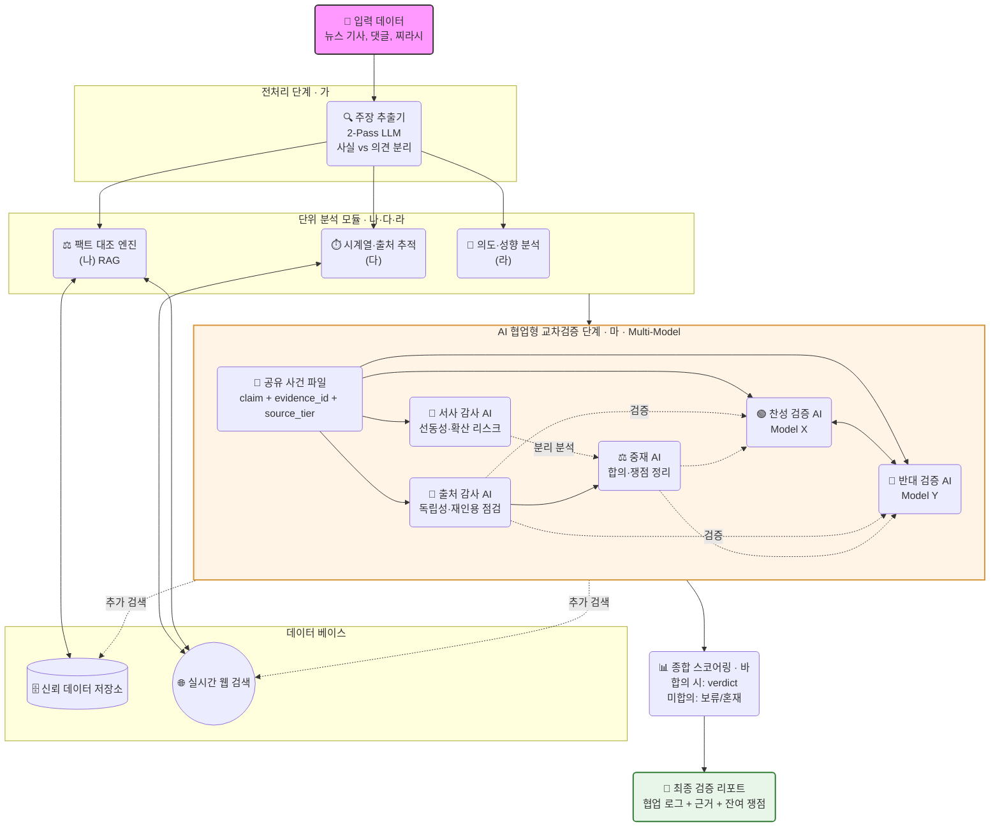

# 생성형 AI 협업·토론을 통한 팩트체크 구현

> **원본**: [특허 내용_v4.hwpx](./특허%20내용_v4.hwpx)
> **변환일**: 2026-05-14
> **변환 범위**: 도식도 설명 + 발명의 상세한 설명 (기술적 구성요소)
> **목적**: 협업·diff 가능한 형태로 옮겨 함께 손보기 위함. 본문은 원본에 충실하게 옮겼고, 표/번호 구조만 마크다운으로 정리.

---

## 1. 도식도 — 생성형 AI 협업·토론을 통한 팩트체크 구현 도식도

\* 교차검증 단계에서 생성형 AI 간 토론 진행

### 1.1 구현 절차 설명

| 단계 | 모듈 | 설명 |
|---|---|---|
| **전처리 단계** | 주장 추출기 | 뉴스 기사, 댓글, 소문 등의 문장에서 필자의 의견과 사실을 분리하는 LLM |
| **검증 단계** | 팩트 대조 엔진 | RAG 기술을 활용하여 팩트로 판단된 신뢰DB에서 1차 대조 |
| **검증 단계** | 시계열 및 출처 추적, 최초 유포자 확인 | RAG 신뢰 DB에서 타임테이블에 따른 출처, 유포자 확인 |
| **검증 단계** | 생성 AI 협업형 교차검증 | 생성형 AI 프롬프트와 OUTPUT을 통한 역할 분담형 AI 협업, 교차 반박, 합의·보류 판단 |
| **검증 단계** | 의도 및 성향 분석 / 선동성·편향성 탐지 | RAG 신뢰DB의 데이터를 활용하여 상용 AI에 정치적으로 판단을 위한 사전 학습을 통해 편향성 탐지 |
| **데이터베이스** | 신뢰 데이터 저장소 | 언론사, 공공기관에서 수집된 신뢰 데이터 수집으로 팩트가 확인된 데이터의 저장 및 활용 |
| **데이터베이스** | 실시간 웹 검색 | 미리 지정한 언론사, 포털 등의 정보를 실시간으로 데이터 수집하여 활용 |

---

## 2. 발명의 상세한 설명 (기술적 구성요소)

### 가. 전처리 및 주장 추출 모듈 (Claim Extraction Module)

입력된 뉴스 기사, 댓글, 소셜 미디어 텍스트 등 비정형 데이터로부터 검증 가능한 '사실(Fact)'과 주관적인 '의견(Opinion)'을 분리하고, 검증 대상을 구조화하는 단계이다. 본 단계는 단순한 키워드 추출이 아닌, **'2-Pass LLM(Large Language Model)' 아키텍처**를 통해 정확도를 극대화한다.

- **입력 정제 및 청킹(Chunking)**: 입력된 텍스트의 노이즈(공백, 특수문자 등)를 제거하고, 모델이 처리 가능한 단위로 분할(Chunking)하되, 메타정보(작성일, 출처 등)를 보존하여 문맥 손실을 방지한다.
- **1차 패스 (Recall 우선 — 후보 추출)**: 시스템은 1차적으로 '재현율(Recall)'을 높이는 데 초점을 맞춘다. 검증 가능성이 조금이라도 있는 문장은 모두 후보군으로 추출하여 누락을 방지하며, 이때 원문의 근거 위치(Source Span)를 함께 태깅한다.
- **2차 패스 (Precision 우선 — 정밀화)**: 추출된 후보군에 대해 '정밀도(Precision)' 중심의 필터링을 수행한다.
  - **사실/의견 분리**: 해당 문장이 사실적시(Factual Assertion)인지 단순 의견인지 라벨링한다.
  - **속성 구조화**: 검증에 필요한 핵심 엔티티(인물, 기관), 시점(Time), 수치(Number) 정보를 정규화하여 추출한다.
- **검증 질문 생성 (Verification Question Generation)**: 단순히 문장을 검색하는 것이 아니라, 팩트체크에 필요한 구체적인 질문(예: "OO기관이 해당 수치를 공식 발표했는가?", "비교 기준 시점이 언제인가?")을 자동으로 생성하여 후속 RAG 단계의 정확도를 높인다.

### 나. 팩트 대조 엔진 (Fact-Checking Engine with RAG)

추출된 주장에 대해 신뢰할 수 있는 데이터베이스(DB)와 대조하여 진위 여부를 판별하는 핵심 모듈이다.

- **질의 생성 및 확장 (Query Generation)**: 앞서 생성된 '검증 질문'을 바탕으로 검색 효율을 높이기 위해 다각도의 쿼리를 생성한다. 정확한 매칭을 위한 '정밀 쿼리(기관명+수치)'와, 다양한 표현을 포괄하는 '완화 쿼리(동의어 포함)', 그리고 공신력 있는 출처를 타겟팅하는 '출처 쿼리'를 복합적으로 생성한다.
- **하이브리드 검색 (Hybrid Retrieval)**: 신뢰 데이터 저장소 및 실시간 웹 검색 결과에 대해 **키워드 매칭(BM25)** 과 **의미 기반 검색(Vector Search)** 을 결합하여 검색한다. 이때 출처의 신뢰도(공공기관 문서 > 주요 언론 > 커뮤니티 등)에 따라 가중치를 부여하여 증거(Evidence)를 수집한다.
- **증거 패키징 및 판정 (Evidence Packing & Judgment)**: 수집된 상위 문서들 중 주장과 직접 관련된 부분(Snippet)만을 추출하여 '증거 패키지'를 구성한다. 이를 기반으로 AI 판정 모델은 **참(True), 거짓(False), 일부 참(Mixed), 판단 보류(Unverified)** 중 하나로 결론을 내린다. 특히 상충되는 증거가 있거나, 1차 자료(Primary Source)가 부재할 경우 자동으로 **'판단 보류'** 로 분류하여 환각 현상(Hallucination)을 방지하는 로직을 포함한다.

### 다. 시계열 및 출처 추적 모듈 (Source Origin Tracking)

가짜 뉴스의 최초 유포자를 식별하고 확산 경로를 파악하기 위한 모듈이다.

- **주장 핑거프린팅 (Claim Fingerprinting)**: 추출된 주장의 핵심 의미를 해시(Hash)화하여, 문장이 조금씩 변형되더라도 동일한 주장임을 식별할 수 있는 고유값(Fingerprint)을 생성한다.
- **패러프레이즈 검색 (Paraphrase Search)**: 최초 유포 시점의 게시물은 현재와 다른 표현을 썼을 가능성이 높으므로, AI가 주장의 의미를 보존한 상태에서 다양한 변형 문장(Paraphrase)을 생성하여 과거 데이터를 역추적 검색한다.
- **타임라인 재구성**: 검색된 데이터들을 시간순으로 정렬(Sorting)하여 최초 등장 시점(Earliest Timestamp)을 식별하고, 해당 출처가 공신력 있는 매체인지 개인 커뮤니티인지 분류하여 '출처 신뢰도' 점수에 반영한다.

### 라. 의도 및 성향 분석 모듈 (Intent & Bias Analysis)

팩트 여부와는 별개로, 텍스트에 포함된 선동성이나 편향성을 분석하여 사용자의 판단을 돕는다.

- **사실과 표현의 분리**: 텍스트에서 '사실 관계(Claim)'와 이를 감싸고 있는 '표현 방식(Framing)'을 분리하여 분석한다.
- **편향 시그널 탐지**: 학습된 AI 모델이 특정 편향 시그널을 탐지한다.
  - **감정적/선동적 언어 (Loaded Language)**: 과도한 혐오 표현이나 감정적 단어 사용.
  - **근거 없는 확신 (Certainty without Evidence)**: 출처 없이 "~카더라", "확실하다" 등의 단정적 표현.
  - **진영 논리 (Us vs Them)**: 특정 집단을 악마화하거나 편 가르기를 하는 화법.
- **이중 레이어 리포팅**: 최종 결과에서 "팩트는 사실(True)이나, 표현 방식은 선동적(High Propaganda Risk)임"과 같이 사실성과 표현성을 입체적으로 스코어링하여 제공한다.

### 마. AI 협업형 교차검증 모듈 (AI Collaboration & Cross-Model Debate Module)

본 발명의 핵심 차별 구성요소로, **단일 LLM의 단독 판정이 갖는 편향·환각·근거 누락 위험**을 줄이기 위해, 서로 다른 기반(base) 모델 또는 서로 다른 학습·정렬 과정을 거친 복수의 생성형 AI가 동일 주장에 대해 **역할 분담형 협업, 상호 반박, 추가 근거 요청, 합의 판정**을 수행하는 메타 모듈이다. 본 모듈은 가·나·다·라 모듈의 출력인 주장, 검증 질문, 증거 패키지, 출처 타임라인, 편향 시그널을 하나의 공유 사건 파일(shared case file)로 구성한 뒤, 이를 복수 AI 참여자에게 배포하여 근거 기반 협업 검증을 진행한다.

#### 마-1. 공유 사건 파일 구성 (Shared Case File)

AI 협업이 임의의 자유 토론으로 흐르지 않도록, 오케스트레이터는 각 주장 단위로 다음 정보를 포함하는 공유 사건 파일을 생성한다.

- **주장 식별 정보**: claim_id, 원문 문장, source span, 작성·수집 시점, 입력 URL 또는 원 출처 메타데이터.
- **검증 질문 목록**: 가 모듈에서 생성된 verification_questions 및 후속 라운드에서 추가된 보충 질문.
- **증거 패키지**: 나 모듈이 수집한 evidence_id, 인용문, 링크, 발행 시점, source_tier(T0~T4), independence_class, credibility_weight.
- **출처·확산 정보**: 다 모듈의 origin_chain, earliest_timestamp, 동일 원문 재인용 여부, 독립 출처 수.
- **표현·서사 정보**: 라 모듈의 bias_score, emotional_load, narrative_pressure_score, propaganda_signals.
- **판정 제약 조건**: T3/T4 단독 근거만으로는 참·거짓 판정 금지, 1차 자료 부재 시 보류 우선, 인과·이권 추정은 사실 판정과 분리.

공유 사건 파일의 모든 증거에는 고유 식별자(evidence_id)를 부여한다. 각 AI 참여자는 판정 또는 반박을 제시할 때 반드시 해당 evidence_id를 참조해야 하며, 식별자 없는 주장은 신규 검증 질문 또는 미검증 가설로만 기록한다.

#### 마-2. 협업 참여자 구성 (Collaborative AI Panel)

본 모듈은 단일 사업자의 LLM이 아닌 **서로 다른 사업자·서로 다른 학습 데이터셋·서로 다른 정렬(alignment) 과정을 거친 모델**을 조합하여 패널을 구성한다. 동일 사업자 또는 동일 학습 계열 모델만 사용할 경우 공통 편향이 공유될 수 있으므로, 본 발명은 **모델 다양성 강제(Mandatory Model Diversity)** 를 핵심 요건으로 한다.

- **찬성 검증 AI (Proponent)**: 해당 주장을 지지하는 증거와 논리를 우선 검토한다. 단, 모든 지지 근거는 evidence_id와 source_tier를 함께 제시해야 한다.
- **반대 검증 AI (Opponent)**: 해당 주장을 반박하거나 약화시키는 증거, 반례, 논리적 빈틈을 우선 검토한다.
- **출처 감사 AI (Source Auditor)**: 증거의 공신력 계층, 독립성, 재인용 여부, 이해관계 위험을 점검한다.
- **서사·편향 감사 AI (Narrative Auditor)**: 사실 판정과 별도로 감정적 표현, 선동성, 집단 확산 리스크, 인과 추정의 과잉 여부를 점검한다.
- **중재 AI (Moderator)**: 각 라운드의 합치점과 차이점을 정리하고, 신규 검증 질문과 추가 검색 요청을 생성하며, 합의 여부와 잔여 쟁점을 구조화한다.

각 참여자는 동일한 공유 사건 파일을 입력받되, 서로 다른 역할 프롬프트와 출력 스키마를 사용한다. 이로써 동일 입력에 대한 다각도 검토가 가능해지고, 특정 모델의 단일 관점이 최종 판정으로 직행하는 것을 방지한다.

#### 마-3. 협업 메시지 스키마 (Collaboration Message Schema)

각 라운드의 발화는 자유 텍스트가 아니라 다음과 같은 구조화 메시지로 기록된다.

```json
{
  "round": 1,
  "agent_role": "proponent|opponent|source_auditor|narrative_auditor|moderator",
  "stance": "supported|refuted|mixed|unknown",
  "claims_addressed": ["claim_001"],
  "evidence_used": ["ev_001", "ev_004"],
  "reasoning_summary": "판단 근거 요약",
  "challenges": [
    {
      "target_agent_role": "proponent",
      "issue": "인용 근거가 T3 재인용 기사에 불과함",
      "required_check": "T0 또는 T1 원문 존재 여부 확인"
    }
  ],
  "retrieval_requests": [
    {
      "query": "공식 통계 원자료 검색 질의",
      "target_tier": "T0|T1",
      "purpose": "1차 자료 확인"
    }
  ],
  "open_issues": ["비교 기준 시점이 불명확함"]
}
```

이 구조화 메시지를 통해 토론 과정 전체가 감사 가능(auditable)하고, 사용자에게 설명 가능한 AI(XAI) 산출물로 제공될 수 있다.

#### 마-4. 라운드 기반 협업 절차 (Round-Based Collaboration Protocol)

1. **R0 — 사건 파일 고정 (Case File Locking)**: 오케스트레이터가 가·나·다·라 모듈의 산출물을 공유 사건 파일로 고정하고, 초기 증거의 출처 계층과 독립성 정보를 부여한다.
2. **R1 — 독립 검토 (Independent Review)**: 각 AI 참여자는 다른 참여자의 의견을 보지 않은 상태에서 독립적으로 supported / refuted / mixed / unknown 중 하나의 입장과 근거를 제출한다.
3. **R2 — 교차 반박 (Cross-Examination)**: 각 AI 참여자는 상대 역할의 R1 출력을 검토하여 근거의 신뢰도, 논리적 일관성, 반례 가능성, 출처 독립성 문제를 지적한다.
4. **R3 — 표적 검색 및 증거 보강 (Targeted Retrieval)**: 중재 AI는 R2에서 제기된 retrieval_requests를 수집하여 RAG 신뢰 DB 또는 실시간 웹 검색에 추가 질의를 발행한다. 신규 증거는 source_tier와 independence_class가 부여된 뒤 공유 사건 파일에 추가된다.
5. **R4~RN — 수렴 시도 (Convergence)**: 신규 증거가 추가될 때마다 각 AI 참여자는 입장을 갱신한다. 단, 사전 정의된 최대 라운드 수 N을 초과하면 강제 종료한다.
6. **RX — 합의 기록 생성 (Consensus Record)**: 중재 AI는 최종 라운드의 입장, 사용 증거, 잔여 쟁점을 종합하여 consensus_record를 생성한다.

#### 마-5. 합의 판단 및 보류 게이트 (Consensus & Hold Gate)

본 모듈에서 "합의"는 단순 다수결이 아니라 다음 조건을 모두 만족하는 경우로 한정한다.

- **모델 합의**: 서로 다른 기반 모델 또는 서로 다른 학습·정렬 계열의 AI 참여자 중 최소 2개 이상이 동일한 stance에 도달할 것.
- **근거 합의**: 합의에 참여한 AI가 동일하거나 상호 보강되는 T0/T1 또는 독립 T2 이상의 증거를 핵심 근거로 인용할 것.
- **출처 독립성**: 동일 원문을 재인용한 복수 기사 또는 게시물은 독립 증거 1건으로만 산정할 것.
- **중대 잔여 쟁점 부재**: 비교 기준 시점, 수치 단위, 원문 존재 여부 등 판정에 영향을 주는 open_issues가 남아 있지 않을 것.

위 조건 중 하나라도 충족하지 못하면 최종 verdict는 참(True) 또는 거짓(False)으로 확정하지 않고, 후속 종합 스코어링 단계에 `unverified`, `hold`, 또는 `mixed` 후보로 전달한다. 특히 T3/T4 계층 근거만 존재하거나, AI 참여자들이 결론은 같더라도 핵심 근거가 서로 다를 경우에는 합의로 보지 않는다.

#### 마-6. 종료 조건 (Termination Criteria)

다음 중 하나가 만족되면 협업 라운드를 종료한다.

- **합의 도달 (Consensus)**: 마-5의 합의 조건을 충족한 경우.
- **증거 포화 (Evidence Saturation)**: 직전 라운드 대비 신규 T0~T2 증거 또는 새로운 반례가 더 이상 인출되지 않는 경우.
- **중대 충돌 고착 (Persistent Conflict)**: 동일 증거에 대한 해석 차이가 반복되고, 추가 검색으로도 해소되지 않는 경우.
- **최대 라운드 도달 (Round Limit)**: 사전 정의된 N 라운드를 초과한 경우.
- **검증 불능 (Unverifiable)**: 원문, 시점, 수치 기준 등 필수 검증 요소가 결여되어 사실 판정이 불가능한 경우.

#### 마-7. 출력 및 인간 검증 큐 연계 (Output & Human-in-the-Loop)

본 모듈은 다음 산출물을 후속 종합 스코어링 및 리포트 생성 단계로 전달한다.

- **debate_transcript**: 각 라운드의 구조화 발화, 반박, 추가 검색 요청, 증거 갱신 이력을 시간순으로 기록한 로그.
- **consensus_record**: 합의 여부, 합의 stance, 합의에 사용된 핵심 evidence_id, 합의 강도(consensus_score).
- **evidence_delta**: 토론 과정에서 새로 추가되거나 신뢰도가 조정된 증거 목록.
- **disagreement_vector**: 모델 간 불일치 원인(근거 부족, 출처 신뢰도 이견, 시점 불일치, 해석 충돌 등)을 구조화한 값.
- **open_issues**: 미해결 쟁점 및 추가 검증 질문 목록.
- **human_review_packet**: 합의 미달 또는 고위험 주장에 대해 전문가 검증 큐로 전달할 사건 요약, 핵심 근거, 쟁점, 추천 검토 항목.

합의에 도달하지 못한 사건은 자동으로 전문가 검증 큐 또는 시민 검증 큐로 전달될 수 있으며, 인간 검증 결과가 축적되면 후속 학습 데이터셋의 `human_label`로 사용된다. 단, Teacher AI의 출력은 직접 정답 라벨로 사용하지 않고, 인간 검증을 통과한 결과만 학습 데이터로 편입한다.

#### 마-8. 기술적 효과 (Technical Effect)

본 AI 협업형 교차검증 모듈은 다음 효과를 제공한다.

- 단일 LLM의 환각 또는 정렬 편향이 곧바로 최종 판정으로 반영되는 것을 차단한다.
- 근거 식별자 기반의 구조화 협업 메시지를 사용하여 토론 과정의 감사 가능성과 재현성을 높인다.
- 다수 언론 보도처럼 보이지만 실제로는 동일 원문을 재인용한 경우를 독립 증거로 과대평가하지 않는다.
- 상위 공신력 근거가 부족한 경우 자동 보류하여, 허위 참 판정(false true)의 법적·사회적 위험을 낮춘다.
- AI 협업 결과와 인간 검증 큐를 연결하여, 서비스 운영 과정에서 한국어 팩트체크 골드 데이터셋을 축적할 수 있다.

### 바. 종합 스코어링 및 리포트 생성 (Final Scoring & Reporting)

상기 모듈들(가~마)의 결과를 종합하여 최종 검증 리포트를 생성한다.

- 팩트 대조 결과(진실/거짓), 출처 추적 결과(최초 유포지 신뢰도), 성향 분석 결과(선동성 지수), **AI 협업형 교차검증 결과(합의 여부 + 잔여 쟁점 + disagreement_vector)** 를 통합 가중하여 최종 **'신뢰도 스코어'** 를 산출한다.
- **AI 협업형 교차검증에서 합의에 도달하지 못한 경우, 종합 verdict는 자동으로 '판단 보류(Unverified)' 또는 '혼재(Mixed)' 로 분류한다.** 단일 모델의 단독 판정만으로는 참(True)·거짓(False) 결론을 내리지 않는다.
- 최종 사용자에게는 단순한 결과뿐만 아니라, **협업 로그(Debate/Collaboration Transcript), 판단의 근거가 된 원문 링크(Evidence Links), 논리적 사유(Rationale), 잔여 쟁점(Open Issues)** 를 함께 제시하여 설명 가능한 AI(XAI)를 구현한다.

---

## 3. 도식도

> 본 도식은 §2 가~바 의 구성요소 흐름과 정렬되어 있다. AI 협업형 교차검증(마)이 단위 분석(나·다·라)과 종합 스코어링(바) 사이의 메타 단계로 들어간다.
> [images/architecture.mermaid](../images/architecture.mermaid) 원본도 동일 구조로 갱신 필요.



---

## 4. 검토 메모 (협업용)

### 4.1 청구항 강도 검토

각 구성요소의 진보성을 평가하고 청구항 배치를 권장한다.

| 구성요소 | 공지기술 여부 | 단독 청구 진보성 | 권장 청구 위치 |
|---|---|---|---|
| 가. 2-Pass LLM 주장 추출 | Recall→Precision 패러다임은 공지. LLM 적용은 2023~ 다수 논문 | 약함 | 종속항 |
| 나. Hybrid RAG (BM25 + Vector) | LangChain·LlamaIndex 표준, 학술 공지 | 매우 약함 | 종속항만. 단독 청구 시 거절 위험 |
| 다. Claim Fingerprinting + Paraphrase + Timeline | schema.org ClaimReview (2017), Google Fact Check Tools, ClaimBuster (2017) | 약함 | 종속항. "한국어 정치 도메인 적용" 한정 시 약간 보강 |
| 라. 사실·표현 분리 + 편향 시그널 | Snopes·PolitiFact 운영, Recasens et al. 2013 등 | 약함 | 종속항 |
| **마. AI 협업형 교차검증 (AI Collaboration + Multi-Model Debate)** | Du et al. 2023, Liang et al. 2023 학술 공지. 단, **모델 다양성 강제 + 공유 사건 파일 + 구조화 협업 메시지 + 미합의 시 verdict 회피** 조합은 신규 가능 | **중간~강 (핵심)** | **독립항** |
| 바. 미합의 시 자동 보류 | 기존 팩트체크 시스템은 단일 verdict 출력이 일반적. 미합의 자동 보류는 새로움 | 중간 | 마와 결합 청구 |

#### 권장 청구 구조 (변리사 검토 전 가안)

- **청구항 1 (독립항, 시스템)**: 가 → (나·다·라 병렬) → **마(공유 사건 파일 생성 + 서로 다른 기반 모델 강제 + 역할 분담형 협업 + 구조화 메시지 + 합의 조건 판단)** → **바(미합의 시 verdict='unverified' 강제)** 결합 시스템
- **청구항 2 (종속)**: 마의 모델 다양성 — 최소 2개 이상 서로 다른 사업자, 학습 데이터셋, 정렬 과정 또는 기반 아키텍처의 LLM
- **청구항 3 (종속)**: 공유 사건 파일 — claim_id, evidence_id, source_tier, independence_class, origin_chain, bias/narrative signal 포함
- **청구항 4 (종속)**: 역할 분담 — 찬성 검증 AI, 반대 검증 AI, 출처 감사 AI, 서사·편향 감사 AI, 중재 AI 중 둘 이상
- **청구항 5 (종속)**: 라운드 구조 — R0 사건 파일 고정 / R1 독립 검토 / R2 교차 반박 / R3 표적 검색 / R4+ 수렴 시도
- **청구항 6 (종속)**: 종료 조건 — 합의 / 증거 포화 / 중대 충돌 고착 / 라운드 한도 / 검증 불능 중 하나
- **청구항 7 (종속)**: 바의 미합의 처리 — 합의 미달 시 verdict 자동 'unverified'/'mixed' 또는 `hold`
- **청구항 8 (종속)**: 협업 로그와 잔여 쟁점을 사용자 UI에 노출하고, 미합의 사건을 인간 검증 큐로 전달
- **청구항 9 (방법항)**: 청구항 1을 단계 a~f 방법으로 변환
- **청구항 10 (기록매체항)**: 청구항 9를 컴퓨터 판독 매체로 변환

#### 진보성 위험과 보강 전략

- 마(교차 토론) 자체는 학술 공지 — Du/Liang 등 2023년 논문에서 다중 에이전트 토론으로 정확도 향상이 이미 보고됨
- **차별 포인트 5개를 청구항 1 본문에 명시적으로 박아야 진보성 인정 가능**:
  1. **모델 다양성 강제** (동일 사업자 LLM 단독 사용 명시적 배제)
  2. **공유 사건 파일 + evidence_id 기반 협업 메시지** (감사 가능한 협업 프로토콜)
  3. **역할 분담형 감사 AI** (찬반뿐 아니라 출처 독립성·서사 편향을 별도 점검)
  4. **라운드 기반 + 명시적 종료 조건** (합의/고갈/충돌/한도/검증 불능)
  5. **미합의 시 verdict 회피** (단일 모델 단독 합의로 true/false 안 냄)
- 가/나/다/라는 단독으로는 진보성 약하나, **마·바와의 결합 청구**로 권리 범위 확보

---

### 4.2 선행기술과의 차별점

| 선행기술 | 핵심 | 본 발명과 차이 |
|---|---|---|
| **Du et al. 2023** — *Improving Factuality and Reasoning in Language Models through Multiagent Debate* | 동일 LLM N 인스턴스가 토론하면 정확도 향상 | Du는 **동일 모델 N 인스턴스**. 본 발명은 **서로 다른 기반 모델 강제 + 공유 사건 파일 + evidence_id 기반 메시지**를 결합. 팩트체크 도메인 특화 및 보류 게이트 포함. |
| **Liang et al. 2023** — *Encouraging Divergent Thinking through Multi-Agent Debate* | 발산적 사고 유도용 토론 | Liang은 사고 발산이 목적. 본 발명은 **수렴 또는 명시적 미합의 처리**가 목적이며, 합의·증거 포화·충돌 고착·검증 불능 등 종료 조건이 명확. |
| **schema.org ClaimReview / Google Fact Check Tools (2017~)** | 클레임을 구조화하고 팩트체커가 라벨 부착 | ClaimReview는 **인간 팩트체커가 라벨**. 본 발명은 **AI 협업형 1차 게이트 + 인간 검증 큐** 결합. |
| **FEVER / ClaimBuster / FactKG 등 학술 모델** | 단일 LLM/분류기로 claim verification | 단일 모델 단독 판정. 본 발명은 **다모델 협업 교차검증 + 출처 감사 + 미합의 시 verdict 회피**. |
| **한국 팩트체크넷 (2018~2024)** | 인간 팩트체커 + 시민 검증 토론 공간 | 인간 토론. 본 발명은 **AI 협업형 교차검증을 1차 게이트**로 두어 인간 검증 큐 부담을 줄이되, 인간 검증과의 결합은 유지. |

#### 본 발명의 진보성 핵심 (5가지)

1. **모델 다양성 강제 (Mandatory Model Diversity)** — 동일 사업자 LLM 단독 사용을 청구항에서 명시적으로 배제. 단일 모델의 정렬·학습 데이터 편향이 결과에 그대로 반영되는 것을 차단.
2. **공유 사건 파일 (Shared Case File)** — claim, evidence_id, source_tier, origin_chain, bias signal을 하나의 협업 단위로 고정하여 AI 참여자의 발화를 감사 가능하게 만듦.
3. **역할 분담형 AI 감사 (Role-Separated AI Audit)** — 찬반 토론뿐 아니라 출처 감사와 서사·편향 감사를 별도 AI 역할로 분리.
4. **공신력 계층 + RAG 와의 결합** — 협업 중 새 증거 인출을 T0~T4 계층 신뢰 DB에서 자동 수행. AI 협업과 retrieval 이 결합된 폐쇄 루프.
5. **명시적 미합의 처리 (Explicit Non-Consensus Handling)** — 합의 미달 시 verdict='unverified'/'mixed' 또는 `hold` 강제. 억지 판정 방지가 알고리즘 자체에 강제됨.

---

### 4.3 갈래(A/B/C) 정체성과의 정렬

> 직전 기획 검토에서 **갈래 C** (특허의 AI 협업형 교차검증 부분만 진짜로 구현, verdict 약화) 를 권장. 본 v4 개정안은 갈래 C 가정으로 작성됨.

| 갈래 | 본 v4 개정안과의 정렬도 | 비고 |
|---|---|---|
| **갈래 A** (verdict 출력 유지) | 양립 가능 | 마+바를 통해 verdict 출력. 단 **미합의 시 자동 보류** 강제로 갈래 A의 법적 리스크(억지 판정) 감소 |
| **갈래 B** (verdict 완전 제거) | **충돌** | 본 청구는 verdict 출력을 포함. 갈래 B로 가려면 마의 출력을 "찬·반 입장 + 잔여 쟁점"만 산출하도록 청구 한정 필요 |
| **갈래 C** (AI 협업형 교차검증 + verdict 약화) | **가장 정렬됨 ✅** | 마의 미합의 비율을 KPI에 포함, 합의 시에만 verdict 출력, UI는 협업 로그 + 근거 카드 + 잔여 쟁점 중심 |

**권장**: 갈래 C 명시 채택 후 **청구항 7(미합의 시 unverified/hold 강제)을 청구항 1 독립항에 흡수**해 권리범위의 핵심으로 박는다. 이렇게 하면 갈래 C 정체성과 IP가 동시 정렬됨.

---

### 4.4 변리사 자문 시 질문 목록

1. **선행기술 검색 (Prior Art Search)**: Du et al. 2023, Liang et al. 2023, ClaimReview, FEVER 외에 KIPRIS·USPTO·EPO 에 등록된 "multi-agent fact-checking", "LLM debate verification", "AI collaboration fact-checking", "교차 토론 팩트체크" 류 특허 검색 결과는?
2. **모델 다양성 청구의 명세 가능성**: "서로 다른 사업자의 LLM 사용"을 청구 한정으로 명시할 수 있는가? "사업자"라는 표현이 청구항에서 허용되는가? 대안 표현 — "서로 다른 학습 데이터셋", "독립된 alignment process 거친 모델", "기반 아키텍처가 다른 모델" 중 어느 게 가장 안전한가?
3. **알고리즘 청구 적격성**: "미합의 시 자동 보류" 알고리즘 자체가 한국 특허법 §29 (산업상 이용가능성·신규성·진보성) 및 §32 (불특허 사유) 를 통과하는가? 소프트웨어/BM 특허 등록 가능성?
4. **청구항 셋트 구성**: 방법항 + 시스템항 + 기록매체항 3종 셋트가 본 발명에 효율적인가? 침해 입증 관점에서 어느 형태가 가장 강한가?
5. **AI 발명 표기 이슈**: 본 발명은 LLM을 사용하지만 발명자는 인간. 발명자·출원인 표기와 AI 발명 거절 사유 회피 방법?
6. **출원 시점**: 갈래(A/B/C) 정체성 합의 전 출원 vs 합의 후 출원 — 어느 쪽이 등록 가능성·권리범위 모두 유리한가? 가출원(Provisional) 활용 여지?
7. **국제출원 (PCT)**: 한국 단독 출원 vs PCT 출원 — 정부과제 예산으로 PCT 비용 커버 가능 범위? 우선권 주장 기간(12개월) 활용 전략?
8. **공지 회피 (Confidentiality)**: 본 v4 문서와 코드 저장소가 GitHub 등에 외부 공개되면 신규성 상실 위험. 출원 전 비공개 유지 절차 (NDA, private repo, 공개 시점 관리)?
9. **회피 설계 대비**: 경쟁사가 본 청구를 회피하기 위해 어느 구성요소를 변형할 가능성이 큰가? (예: 모델 다양성 → 동일 모델 다른 프롬프트, 미합의 시 보류 → 다수결 등) 그 회피 경로를 미리 청구 범위에 포함시킬 수 있는가?
10. **존속기간·등록 비용**: 출원~등록까지 통상 18~24개월, 등록 후 20년. 정부과제 종료 후 갱신료 부담 주체는?
