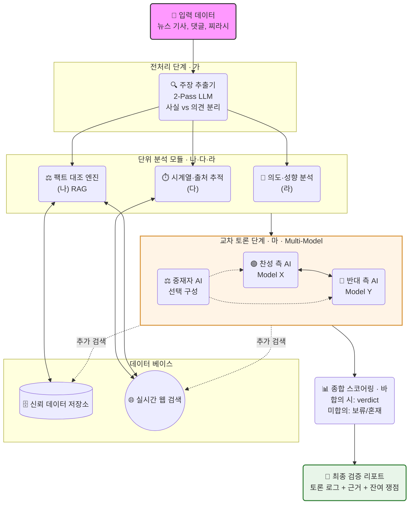

# Marbas

Marbas는 실시간 이슈, 소문, 기사 본문을 넣으면 사실 주장 단위로 분해하고, 출처 추적과 근거 대조를 통해 검증 리포트를 만드는 실험적 검증 시스템입니다.

현재 저장소의 프로토타입은 로컬 Ollama 기반이지만, 초기 제품화 계획은 `ChatGPT API(OpenAI API)`를 기본 LLM 백엔드로 사용하는 방향입니다. 코드명은 `Marbas`, 서비스 성격은 `issue verification / fact checking assistant`에 가깝고, 설계 성향은 `agent-first`에 가깝습니다.

## 목차

- [What It Does Now](#what-it-does-now)
- [Architecture](#architecture)
- [API](#api)
  - [GET /health](#get-health)
  - [GET /version](#get-version)
  - [POST /api/verify](#post-apiverify)
- [Local Run](#local-run)
- [Current Status](#current-status)
- [Naming](#naming)
- [About Marbas](#about-marbas)
- [Disclaimer](#disclaimer)
- [Frontend](#frontend)
- [Planning Notes](#planning-notes)

---

## What It Does Now

- `POST /api/verify`로 입력 텍스트를 받아 사실 주장들을 추출합니다.
- claim마다 세 개의 분석 축을 병렬로 수행합니다.
  - `Agent A`: 최초 출처와 타임라인 후보를 추적합니다.
  - `Agent B`: 주장을 근거와 대조해 `supported | refuted | unknown`을 판단합니다.
  - `Agent C`: 선동성, 편향, 감정 유발 위험을 분석합니다.
- 마지막에 aggregator가 최종 `true | false | hold` 판정과 경고 메시지를 조합합니다.

## Architecture

> 본 도식은 [특허 v4 개정안](./docs/특허_내용_v4.md) 기준의 목표 아키텍처입니다. 현재 구현 상태는 [src/server.js](./src/server.js) 등 코드 진입점 참조. 도식 원본은 [images/architecture.mermaid](./images/architecture.mermaid).



현재 파이프라인은 아래 흐름으로 구성되어 있습니다.

1. 입력 텍스트 수신
2. claim extraction
3. origin / factcheck / intent agent 병렬 실행
4. aggregate
5. report 반환

초기 제품화에서는 이 구조를 더 agent 중심으로 확장할 예정입니다.

- `Intake Agent`: 입력 정규화와 작업 분기
- `Claim Agent`: 사실 주장 추출
- `Source Agent`: 출처 추적과 타임라인 정리
- `Fact Agent`: 근거 대조와 판정
- `Narrative Agent`: 편향, 선동성, 분위기 전염 분석
- `Report Agent`: 최종 리포트 생성
- `Crawl/Collection Agent`: 웹 수집과 본문 정리

## API

### `GET /health`

서버 상태 확인용 엔드포인트입니다.

### `GET /version`

앱 버전과 LLM 백엔드 연결 상태를 반환합니다. (현재 Ollama, 향후 OpenAI로 전환 예정)

### `POST /api/verify`

입력 예시:

```json
{
  "text": "여기에 기사 본문이나 소문 텍스트를 넣습니다.",
  "url": "https://example.com/article",
  "collected_at": "2026-03-22T12:00:00Z"
}
```

현재 제약:

- `text`는 필수입니다.
- `url` 필드는 전달되지만 아직 실제 본문 수집에는 사용되지 않습니다.
- 웹 검색은 아직 stub 상태입니다.

## Local Run

```bash
npm install
npm run dev
```

기본 포트는 `8080`입니다.

환경 변수는 `.env`에서 관리합니다.

- `PORT`
- `OLLAMA_BASE_URL`
- `OLLAMA_MODEL`
- `OLLAMA_TIMEOUT_MS`
- `TRUSTED_DB_PATH`
- `TRUSTED_DB_TOPK`
- `WEB_SEARCH_ENABLED`

## Current Status

현재 이미 구현된 항목:

- Express 서버와 기본 엔드포인트
- 로컬 Ollama JSON 응답 처리
- claim extraction
- origin / factcheck / intent agent 분리
- 간단한 RAG 검색 구조
- claim별 검증 리포트 생성

초기 제품화 방향:

- 기본 LLM provider는 `ChatGPT API(OpenAI API)`로 잡습니다.
- Ollama는 초기 범위에서 제외하고, 나중에 로컬 provider 옵션으로 검토합니다.
- 이 프로젝트는 `agent-first` 방향으로 진행하며, LLM 호출도 단일 체인보다 다중 agent orchestration 쪽에 무게를 둡니다.
- 크롤링과 본문 정리도 직접 파서보다 `AI-assisted extraction` 중심으로 가져가고, deterministic parsing은 최소 메타데이터 추출에 한정합니다.

아직 미구현 또는 임시 상태인 항목:

- 실제 신뢰 DB seed 파일
- 실제 웹 검색 adapter
- URL 기반 본문 수집
- 의견성 claim 필터링
- 공신력 계층화
- 독립 출처 판정
- 집단 확산 리스크 분석

## Naming

프로젝트명 `Marbas`는 Ars Goetia의 Marbas에서 가져왔습니다. 현재 프로젝트 방향과 잘 맞는 이유는 `숨은 일에 대한 진실한 답`과 `기계기술`이라는 이미지가 함께 있어서, 기술 기반 진실 검증 시스템의 코드명으로 적합하기 때문입니다.

## About Marbas

`Marbas`는 Ars Goetia에 등장하는 정령으로, 이 프로젝트에서는 단순히 어두운 분위기의 이름이 아니라 기능적 상징으로 차용했습니다.

기록상 Marbas는 대체로 다음과 같은 성격으로 묘사됩니다.

- 숨겨진 일에 대해 진실한 답을 주는 존재
- 병을 일으키기도 하고 치유하기도 하는 이중적 존재
- 기계기술과 기술적 지식에 연결되는 존재
- 처음에는 큰 사자 형태로 나타나고 이후 인간형으로 변하는 존재

이 프로젝트가 `Marbas`라는 이름을 쓰는 이유는 아래와 같습니다.

- 이 시스템의 핵심 목표가 `숨겨진 사실을 드러내는 것`이기 때문입니다.
- 단순 신비주의보다는 `기술 기반 분석 엔진`의 성격이 강하기 때문입니다.
- 진실 판별 시스템은 잘 설계하면 혼란을 줄이지만, 잘못 설계하면 오히려 왜곡을 키울 수 있다는 점에서 Marbas의 이중성과도 닿아 있습니다.

현재 저장소에 포함된 [ars_goetia_72_demons_detailed.csv](/home/gbox3d/work/issue_debugger/ars_goetia_72_demons_detailed.csv) 기준으로 Marbas는 다음처럼 정리되어 있습니다.

- 번호: 5
- 계급: President
- 지휘 군단: 36
- 핵심 권능: 병과 기계기술
- 상세 능력 요약: 숨은 일에 대한 진실한 답, 질병 유발·치유, 기계기술, 변신

그래서 `Marbas`는 이 프로젝트에서 `숨은 사실을 해부하고 기술적으로 검증하는 엔진`이라는 의미를 갖습니다.

## Disclaimer

이 시스템의 검증 결과는 참고 자료이며, 최종 판단은 사용자의 몫입니다. Marbas는 근거가 부족할 경우 억지 판정을 내리지 않고 `hold`를 반환하도록 설계되어 있지만, LLM 기반 분석의 한계로 인해 오류가 포함될 수 있습니다. 중요한 의사결정에는 반드시 원문과 1차 자료를 직접 확인하세요.

## Frontend

프론트엔드는 React 기반이며, `/frontend` 디렉터리에서 독립적으로 관리됩니다.

```bash
cd frontend
npm install
npm run dev      # 개발 서버
npm run build    # 프로덕션 빌드 → dist/
```

프로덕션 빌드 결과물은 nginx를 통해 `http://bsqai01.iptime.org:21080/marbas`로 서빙됩니다.

## Planning Notes

상세 계획과 작업 로그는 아래 문서에 정리되어 있습니다.

- `_forAI/plan.md`
- `_forAI/dev_log.md`
